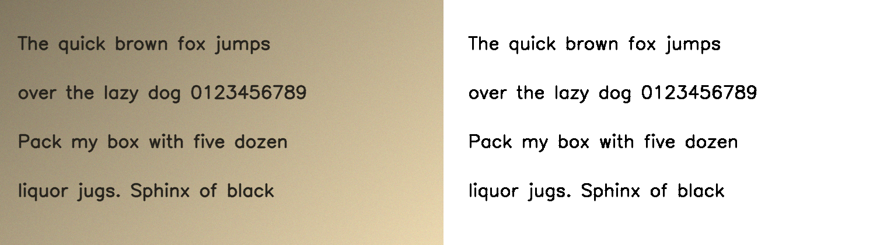

# Image Binarization

Turn photos of pages, scans, screenshots and PDFs into clean black and white. It runs on any CPU, takes well under a second per page, and explains what it did.



- **Tuned to each image.** It measures each image's stroke width, text size, lighting and noise, and derives its settings from them. There are no fixed magic numbers.
- **Knows what it's looking at.**
  - Documents are thresholded.
  - Photos are dithered, so they stay recognisable instead of turning into outlines.
  - Light-on-dark pages (dark mode) are flipped to black text on white.
- **Explains itself.** Every output comes with a report of what was detected and decided.
- **Measured.** It is benchmarked on the standard DIBCO document-binarization datasets, and you can reproduce the numbers with one command.

## Results

DIBCO 2017 plus H-DIBCO 2016: 30 degraded historical documents with hand-made ground truth.

| Method | FM ↑ | PSNR ↑ | DRD ↓ | Time per image |
|---|---|---|---|---|
| Otsu (global) | 80.69 | 15.16 | 12.24 | 0.004 s |
| Sauvola (window 25, k 0.2) | 81.11 | 15.69 | 6.79 | 0.05 s |
| **This project** | **86.66** | **16.97** | **5.24** | 0.18 s |

How to read the scores:
- **FM:** F-measure of ink pixels, as a percentage.
- **PSNR:** in dB.
- **DRD:** distance-reciprocal distortion; lower is better.

Per dataset, FM is 86.8 on DIBCO 2017 (Otsu: 77.7) and 86.4 on H-DIBCO 2016, where plain Otsu is effectively tied at 86.6. This project still has the better PSNR and DRD there.

For context, state-of-the-art deep-learning methods score higher on these datasets. This is a fast classical method, not a neural network.

## Install

Python 3.10 or newer.

```bash
python -m venv venv
venv\Scripts\activate          # Windows  (Linux/macOS: source venv/bin/activate)
pip install -r requirements.txt
```

Or run `setup.bat` (Windows) or `./setup.sh` (Linux/macOS). Each creates the venv, installs the requirements and runs the tests.

## Use

**Command line**

```bash
python main.py --input page.jpg                 # -> outputs/page_bw.png
python main.py --input scans/ -o clean/         # every image and PDF in a folder
python main.py --input book.pdf --json          # one JSON report per page
python main.py --input photo.jpg --mode document  # override auto-detection
```

Outputs are 1-bit PNGs that keep the input's DPI. PDF pages are rendered at 300 DPI.

**Python**

```python
import cv2
from pipeline import binarize

result = binarize(cv2.imread("page.jpg"))      # grayscale, BGR or BGRA
cv2.imwrite("page_bw.png", result.binary)      # uint8, 0 = black, 255 = white
print(result.report.summary())
```

**Web demo**

```bash
python app.py        # http://127.0.0.1:7860 (local only; add --share-lan to expose on your network)
```

## How it works

```
image ─► grayscale ─► classify ─┬─ blank    ─► solid white
                                ├─ photo    ─► contrast stretch ─► Floyd–Steinberg dithering
                                └─ document ─► flip if light-on-dark
                                               ─► measure stroke width
                                               ─► estimate the paper, divide it out
                                               ─► Otsu threshold
                                               ─► remove specks smaller than the strokes
```

1. **Classify** ([pipeline/analysis.py](pipeline/analysis.py)). The image is a photo if, after the paper layer is estimated, that layer still contains structure, or if many pixels are mid-tones. Documents have smooth paper with pixels that are either paper or ink. A mostly-dark image counts as a dark-mode page only if flipping it produces a clean page.
2. **Measure.** Stroke width is twice the median distance from the ink's centre line to the paper. Character height is the median height of glyph-sized marks.
3. **Flatten the lighting** ([pipeline/illumination.py](pipeline/illumination.py)):
   - A morphological closing with a kernel 2× the stroke width erases the ink and leaves the paper.
   - Dividing by that paper estimate removes shadows, yellowing and colour casts.
   - This is the step that matters most: it is what lets a single global threshold work on phone photos.
4. **Threshold and clean up** ([pipeline/binarization.py](pipeline/binarization.py)):
   - Otsu's threshold is applied to the flattened page.
   - Ink blobs smaller than half the stroke width squared are removed.

All settings live in [config.py](config.py):
- The document-path settings (kernel factor, working size, speck size) were picked by a parameter sweep on the benchmark.
- The photo-detection thresholds were set from the test images described under Limitations.

### The report

```json
{
  "kind": "document",
  "mode": "auto",
  "photo_score": 0.143,
  "inverted": false,
  "stroke_width_px": 3.82,
  "char_height_px": 17.0,
  "threshold": 155.0,
  "contrast": 0.761,
  "specks_removed": 0,
  "ink_fraction": 0.039,
  "seconds": 0.077,
  "warnings": []
}
```

Warnings flag text that is too small for reliable results (under about 12 px tall) and faint ink (low ink-to-paper contrast).

## Reproduce the benchmark

Download the datasets from the official DIBCO pages:
- [DIBCO 2017](https://vc.ee.duth.gr/dibco2017/benchmark/): `DIBCO2017_Dataset.7z` and `DIBCO2017_GT.7z`
- [H-DIBCO 2016](https://vc.ee.duth.gr/h-dibco2016/benchmark/): the original and GT zips

Extract them under `data/`, then run:

```bash
python -m benchmark.run \
  --images data/dibco2017/Dataset            --gt data/dibco2017/GT \
  --images data/hdibco2016/DIPCO2016_dataset --gt data/hdibco2016/DIPCO2016_Dataset_GT
```

Metrics are implemented in [benchmark/metrics.py](benchmark/metrics.py): FM, PSNR, and DRD following Lu et al., 2004. Pseudo-FM is not included.

## Limitations

- **Faint, thin print** next to bold text can break up, because one global threshold serves the whole page. Hysteresis and Sauvola refinements were tried and made the benchmark worse overall.
- **Mixed pages:** a page containing a photo is handled as a whole, either all thresholded or all dithered. Detecting regions within a page isn't implemented yet.
- **Very large solid dark areas** in documents (thick bars, filled shapes) can be partly lightened by the flattening step.
- **Photo detection is a heuristic.** It was checked on the 30 benchmark documents and a handful of photos. Override it with `--mode` when it guesses wrong.
- **No deskewing or perspective correction** for tilted phone photos.

## Project layout

```
pipeline/
  analysis.py        classify image type, measure strokes
  illumination.py    estimate and divide out the paper
  binarization.py    binarize(), the report, dithering, speck removal
  files.py           images and PDFs in, 1-bit PNGs out
benchmark/
  metrics.py         FM, PSNR, DRD
  run.py             benchmark CLI
utils/image_io.py    loading (EXIF rotation, transparency, 16-bit), PDF rendering, saving
config.py            all tunable settings
main.py              command line
app.py               web demo
tests/               pytest suite with synthetic pages
```

Run the tests with `python -m pytest tests -q`.

## License

MIT. See [LICENSE](LICENSE).
